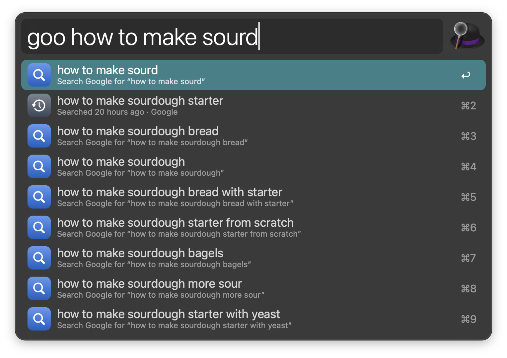
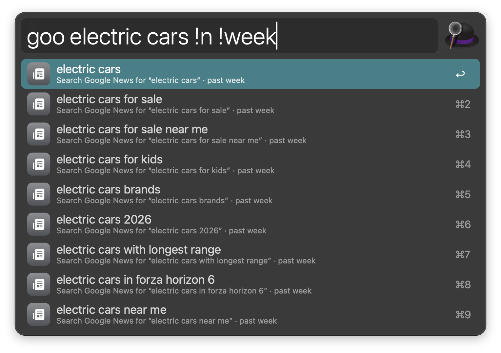
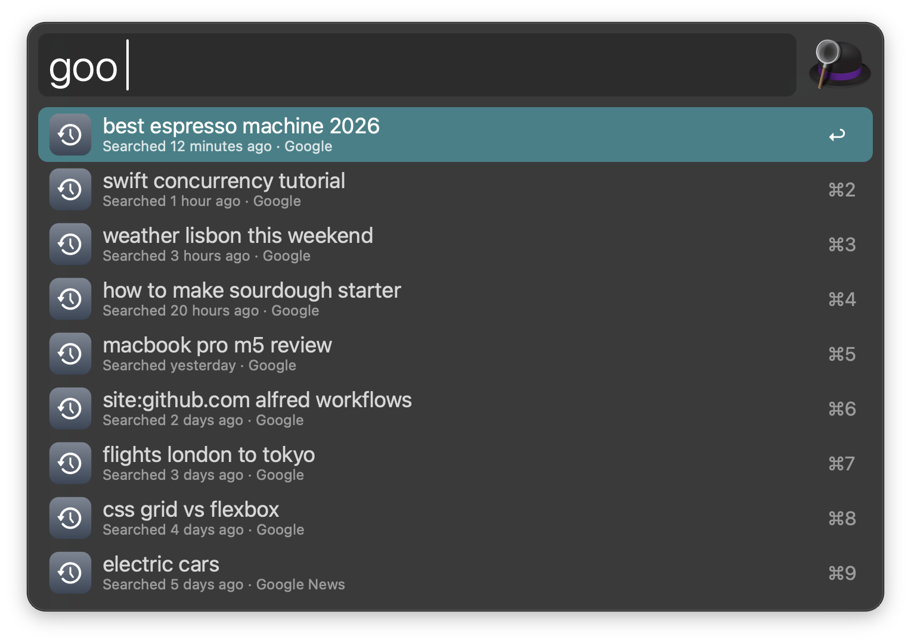
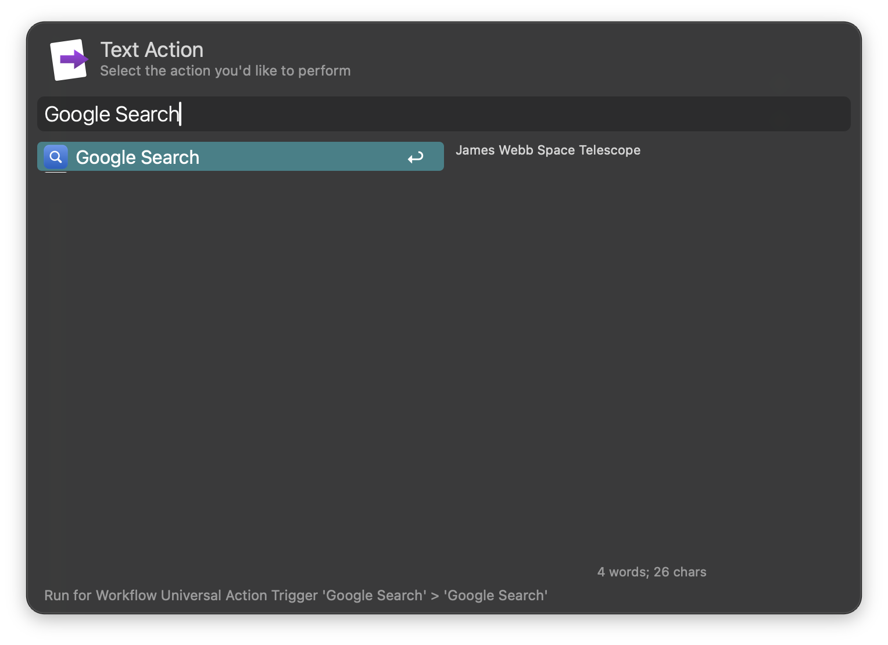

#  Google Search

Search Google from Alfred with live suggestions, your recent searches, and the selected text.

## Usage

Search Google via the `goo` keyword. What you type is always the first result, followed by your matching recent searches and Google’s suggestions as you type. Press <kbd>⇥</kbd> to complete a suggestion, and <kbd>↩</kbd> to search it. Suggestions for websites open the site directly, and calculations show their result.



* <kbd>↩</kbd> Search Google.
* <kbd>⌘</kbd><kbd>↩</kbd> Copy the search URL.
* <kbd>⌥</kbd><kbd>↩</kbd> Search Google Images.
* <kbd>⌃</kbd><kbd>↩</kbd> I’m Feeling Lucky: open the first result.
* <kbd>⇧</kbd><kbd>↩</kbd> Search the web results only, without an AI Overview.
* <kbd>fn</kbd><kbd>↩</kbd> Search results from the past week (the time range is set in the Workflow’s Configuration).
* <kbd>⌘</kbd><kbd>⇧</kbd><kbd>↩</kbd> Search in a private window, which isn’t remembered.
* <kbd>⌘</kbd><kbd>Y</kbd> Preview the results with Quick Look.

On a calculation, <kbd>↩</kbd> copies the result and <kbd>⌘</kbd><kbd>↩</kbd> pastes it into the frontmost app.

Add a shortcut anywhere in the query to search something else: `!i` Images, `!n` News, `!v` Videos, `!s` Shopping, `!w` Web, `!ai` AI Mode, and `!h`, `!d`, `!week`, `!m` or `!y` for the past hour, day, week, month or year. Google’s own operators, like `site:apple.com` or `filetype:pdf`, work as usual.



Leave the query empty to see your recent searches. They are stored only on this Mac.



* <kbd>⌘</kbd><kbd>⌥</kbd><kbd>↩</kbd> Remove the search from the history.

Select **Clear Search History…** at the end of the list, or type `:clear`, to delete them all.

Search the selected text via the Universal Action, or configure the Hotkey to search it from any app. With nothing selected, the Hotkey searches the clipboard instead.



Optionally, add Google Search to Alfred’s Fallback Searches (Features → Default Results → Setup fallback results) to get suggestions for anything Alfred can’t find.

Choose what <kbd>↩</kbd> searches (like Web without the AI Overview, or Images), the browser, private windows, SafeSearch, the language and region, how many searches are remembered, and what the Hotkey does in the Workflow’s Configuration. Turn off suggestions there to keep the workflow offline.

## Development

```bash
swift tools/make_icons.swift tools/icons.json src   # regenerate icons
python3 tools/build.py --package                     # write src/info.plist and dist/*.alfredworkflow
python3 -m unittest discover -s tests                # run the tests
```

## AI disclosure

This workflow was developed with the help of Claude (Anthropic), an AI assistant. The code is reviewed and tested by the author.
